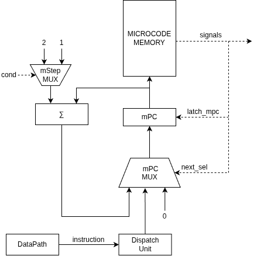

# Meow. Транслятор и модель

<!-- markdown-toc start -->

**Table of Contents**

- [Meow. Транслятор и модель](#meow-транслятор-и-модель)
- [Язык программирования](#язык-программирования)
- [Организация памяти](#организация-памяти)
- [Система команд](#система-команд)
  - [Набор инструкций](#набор-инструкций)
    - [Register-Immediate Instructions & jalr (I-type)](#register-immediate-instructions-jalr-i-type)
    - [Load Upper Immediate & Halt (U-type)](#load-upper-immediate-halt-u-type)
    - [Register-Register Instructions (R-type)](#register-register-instructions-r-type)
    - [Jumps (J-type)](#jumps-j-type)
    - [Branches (B-type)](#branches-b-type)
    - [Store (S-type)](#store-s-type)
    - [Load (I-type)](#load-i-type)
    - [Input (I-type) and Output (S-type)](#input-i-type-and-output-s-type)
    - [Vector-to-Vector (R-type)](#vector-to-vector-r-type)
    - [Vector Store (S-type)](#vector-store-s-type)
    - [Vector Load (I-type)](#vector-load-i-type)
    - [Set Vector Length (I-type)](#set-vector-length-i-type)
  - [Кодирование инструкций](#кодирование-инструкций)
    - [Бинарное представление](#бинарное-представление)
- [Транслятор](#транслятор)
- [Модель процессора](#модель-процессора)
  - [DataPath](#datapath)
  - [ControlUnit](#controlunit)
  - [Бинарное представление микроинструкции](#бинарное-представление-микроинструкции)
- [Тестирование](#тестирование)
  - [Тестирование векторных инструкций](#тестирование-векторных-инструкций)

## <!-- markdown-toc end -->

- Преподаватель: Пенской Александр Владимирович.
- Выполнил: Горелов Илья Александрович, P3231
- `alg | risc | harv | mc | stream | port | cstr | vector | alg1`

## Язык программирования

```ebnf
program             = { top_level_statement }

top_level_statement = comment
                    | declaration
                    | function
                    | const_declaration
                    | while_statement
                    | if_statement
                    | continue_statement
                    | break_statement
                    | return_statement
                    | output_statement
                    | call_statement
                    | assignment
                    | int128_statement

declaration         = type identifier "=" initializer ";"

const_declaration   = "const" type identifier "=" initializer ";"

type                = primitive_type

                    | array_type

primitive_type      = "int"
                    | "int128"
                    | "long"
                    | "byte"
                    | "string"
                    | "bool"

array_type          = array_element_type "[]"

array_element_type  = "int"
                    | "long"
                    | "byte"
                    | "bool"

function            = return_type identifier "("[ parameter_list ]")" block

return_type         = type | "void"

parameter_list      = parameter { "," parameter }

parameter           = type identifier

block               = "{" { body_statement } "}"

body_statement      = comment
                    | declaration
                    | const_declaration
                    | assignment
                    | call_statement
                    | while_statement
                    | if_statement
                    | continue_statement
                    | break_statement
                    | return_statement
                    | output_statement
                    | int128_statement

assignment          = lvalue "=" initializer ";"

lvalue              = identifier [ "[" expression "]" ]

call_statement     = function_call ";"

return_statement   = "return" [ expression ] ";"

output_statement   = "meow" "(" expression ")" ";"

continue_statement = "continue" ";"

break_statement    = "break" ";"

while_statement     = "while" "(" expression ")" block ;

if_statement        = "if", "(" expression ")"
                      block
                      [ "else" block ] ;

initializer         = expression
                    | array_creation
                    | array_literal

array_creation      = "new" array_element_type
                      "[" expression "]"

array_literal       = "{" expression { "," expression } "}"

expression          = logical_or

logical_or          = logical_and { "||" logical_and }

logical_and         = bitwise_or { "&&" bitwise_or }

bitwise_or          = bitwise_and { "|" bitwise_and }

bitwise_and         = equality { "&" equality }

equality            = comparison
                      { ("==" | "!=") comparison }

comparison          = additive
                      { ("<" | ">" | "<=" | ">=") additive }

additive            = multiplicative
                      { ("+" | "-") multiplicative }

multiplicative      = unary,
                      { ("*" | "/" | "%") unary }

unary               = "-" unary
                    | postfix

postfix             = primary { "[" expression "]" }

primary             = number_literal
                    | string_literal
                    | char_literal
                    | bool_literal
                    | variable
                    | function_call
                    | input_call
                    | "(" expression ")"

variable            = identifier

function_call       = identifier
                      "(" [ argument_list ] ")"

argument_list       = expression { "," expression }

input_call          = "hear" "()"

number_literal      = decimal_integer
                    | hexadecimal_integer
                    | binary_integer
                    | octal_integer

string_literal      = '"' { string_character } '"'
char_literal        = "'" character "'"
bool_literal        = "true" | "false"

comment             = COMMENT

int128_statement    = "int128" "." "setLength",
                      "(" expression ")" ";"
```

Примечания:

- Создание массива с помощью `int[] array = new int[param]` ожидает в качестве параметра только численный или символьный литерал.
- Создание массива с помощью `int[] array = {param1,param2,...}` ожидает в качестве параметров только численные или символьные литералы.
- `int128.setLength(param)` задает количество элементов вектора, над которыми выполняются операции.
- `int128.setLength(param)` ожидает в качестве параметра только численный литерал от 1 до 4.
- Вектор можно создать двумя способами:
  - указать элементы сразу: `int128 vec = {1,1,1,1};` или даже так `int128 vec = "abcd";`
  - либо установить значение с помощью вспомогательного массива: - ```meow
    int[] data = {1,1,1,1};

             int128 vec = data[0]; # возьмет 4 элемента, начиная с индекса 0
          ```

    Порядок вычисления выражений

- Выражения вычисляются слева направо.
- Для бинарных операторов сначала вычисляется левый операнд, затем правый.

Вызовы функций

- Вычисляются аргументы функции слева направо. Каждый аргумент кладется в регистр a(0-7) последовательно.
- Выполняется тело функции.
- При встрече return функция возвращает результат вызывающему коду в регистрах a(0-1)

Области видимости:

- глобальная. Переменные, объявленные здесь, сохраняются в глобальной памяти.
- область видимости функции. Переменные, объявленные здесь сохраняются на стеке (за исключением массивов, которые всегда хранятся в глобальной памяти). После возврата из функции указатель стека возвращается в исходное состояние.

Типизация — статическая

Типы:

- `int` -- целое число (32 бита)
- `long` -- целое число (64 бита)
- `byte` -- целое число (8 бит)
- `bool` -- целое число (8 бит), всегда хранит либо 0, либо 1
- `string` -- строка, на уровне парсера преобразуется в массив `byte[]`
- `int128` -- 128-битный вектор, состоящий из `int`

Виды литералов:

| Вид        | Примеры                 |
| ---------- | ----------------------- |
| Числовые   | `123`, `0x234`, `0b111` |
| Строковые  | `"string" `             |
| Символьные | `'s'`, `'\n'`           |
| Логические | `true`, `false`         |

Примечания:

- Все литералы на этапе лексического или синтаксического анализа представляются в виде числовых значений.

## Организация памяти

```
       Registers
+----------------------------------------------+
| x0 (zero) - zero                             |
| x1 (ra) - return address for a call          |
| x2 (sp) - stack pointer                      |
| x3 (gb) - global pointer                     |
| x4 (tp) - thread pointer                     |
| x5-x7 (t0-t2) - temporary registers          |
| x8-x9 (s0-s1) - callee-saved registers       |
| x10-x17 (a0-a7) - argument registers         |
| x18-x27 (s2-s11) - callee-saved registers    |
| x28-x31 (t3-t6) - temporary registers        |
| pc                                           |
+----------------------------------------------+

       Vector Registers
+-----------------------------------+
| v0-v7                             |
+-----------------------------------+

       Instruction memory
+------------------------------+
| 0   : program start          |
|    ...                       |
|    ...                       |
+------------------------------+

       Data Memory
+------------------------------+
| 00 : constant / variable     |
| 01 : array                   |
| 02 : vector                  |
|    ...                       |
|                              |
|    Stack                     |
|    ...                       |
| s-12: function variable      |
| s-8: saved register          |
| s-4: return address          |
| s+0: stack pointer           |
|                              |
+------------------------------+
```

Память команд:

- Машинное слово 32 бита.
- Все команды записываются в память последовательно
- Функции записываются в память после основной программы, т.е. после `HALT`
- Если инструкция использует относительную адресацию, то трансляция происходит в 2 этапа:
  - сохраняются адреса меток
  - вычисляются смещения

Память данных:

- Машинное слово 32 бита.
- Все данные записываются в память последовательно в соответствии с появлением соответствующих им переменных в коде

1. Работа с литералами

- Непосредственная адресация может быть использована только в заранее определенных Immediate инструкциях
- Литералы, используемые для инициализации глобальных переменных и массивов, могут сохраняться непосредственно в статической памяти
- Литералы размещаются в памяти в соответствии с заранее определённым транслятором типом (long, int, byte)
- Если литерал выходит за размер машинного слова, то он будет сохранен как Big-endian

2. Работа с константами

- Константы размещаются в памяти также, как и обычные переменные. Однако им уже нельзя присвоить новое значение 3. Работа с переменными
- Статическая память: глобальные переменные размещаются в секции данных. Их адрес известен на этапе компиляции.
- Стек: локальные переменные функций размещаются в стековом кадре. Для доступа к ним используются смещения относительно указателя кадра `s0` или указателя стека `sp`.
- Регистры: во время вычислений значения переменных загружаются в регистры общего назначения. Для этого используются инструкции `lw` и `lb`.
- Для сохранения значений из регистров в память используются инструкции `sw` и `sb`.
- Если регистров недостаточно для одновременного хранения всех необходимых значений, временные значения сохраняются в стеке, а затем при необходимости загружаются обратно.
- Массивы размещаются в памяти, а переменная массива хранит адрес его первого элемента. Для доступа к элементам вычисляется адрес нужного элемента.
- Переменные типа long занимают два 32-битных слова и при загрузке или сохранении обрабатываются как пара слов.

4. Работа с инструкциями

- Инструкции хранятся в отдельной памяти.
- Каждая инструкция занимает 4 байта.
- Ассемблер преобразует мнемоники инструкций в машинные коды.
- Во время выполнения процессор считывает инструкцию по адресу, заданному счётчиком команд PC, декодирует её и выполняет соответствующую операцию.
- Переходы и вызовы процедур изменяют значение PC.

5. Работа с процедурами

- Вызов функции осуществляется инструкцией jal, которая сохраняет адрес возврата в регистре ra и передаёт управление процедуре.
- Аргументы передаются через регистры a0–a7
- Возвращаемое значение передаётся через регистр a0. Для типа long, занимающего два машинных слова, используются два регистра.
- При входе в процедуру создаётся стековый кадр, в котором размещаются локальные переменные и сохраняются необходимые регистры.
- Адрес возврата ra и указатель предыдущего кадра s0 сохраняются в стеке, чтобы их значения не потерялись при выполнении процедуры.
- При завершении функции восстанавливаются сохранённые регистры и указатель стека. Возврат к вызывающему коду осуществляется через jalr.

## Система команд

Особенности процессора:

- Машинные слова для инструкций и данных — 32 бита
- Доступ к памяти данных осуществляется по адресу, хранящемуся в специальном регистре `AR`. Установка адреса осуществляется путём чтения адреса из указанного регистра с добавлением сдвига.
- Для работы с непосредственными значениями предоставляются специальные директивы:
  - %hi(symbol) - получить старшие 20 бит
  - %lo(symbol) - получить младшие 12 бит
- Обработка данных осуществляется по текущему адресу арифметическими операциями, а также через ввод/вывод.
- Ввод и вывод выполняются с помощью специальных команд `IN`, `OUT`.
- Ввод-вывод осуществляется как поток токенов
- Поток управления:
  - инкремент `PC` после каждой инструкции;
  - условные и безусловные переходы.

### Набор инструкций

#### Register-Immediate Instructions & jalr (I-type)

| OPCODE  | funct3 | Инструкция                 | Кол-во тактов | Описание                                      |
| :-----: | :----: | -------------------------- | ------------- | --------------------------------------------- |
| 0000001 |  000   | `addi <rd>, <rs1>, <imm>`  | 1             | `rd = rs1 + imm`                              |
| 0000001 |  001   | `slti <rd>, <rs1>, <imm>`  | 1             | `rd = (rs1 < imm) ? 1 : 0`                    |
| 0000001 |  010   | `sltiu <rd>, <rs1>, <imm>` | 1             | works like `slti`, but comparison is unsigned |
| 0000001 |  011   | `xori <rd>, <rs1>, <imm>`  | 1             | `rd = rs1 xor imm`                            |
|    -    |   -    | `mv <rd>, <rs1>`           | 1             | `addi <rd>, <rs1>, 0`                         |
| 0000101 |   -    | `jalr rd, offset(rs1)`     | 1             | 1. `rd = pc` 2. `pc=rs1 + offset`             |

#### Load Upper Immediate & Halt (U-type)

| OPCODE  | Инструкция        | Кол-во тактов | Описание                                          |
| :-----: | ----------------- | ------------- | ------------------------------------------------- |
| 0000010 | `lui <rd>, <imm>` | 1             | loads 20-bit immediate into upper 20 bits of `rd` |
| 0001011 | `halt`            | 1             |                                                   |

#### Register-Register Instructions (R-type)

| OPCODE  | funct3 | funct7  | Инструкция          | Кол-во тактов | Описание                               |
| :-----: | :----: | :-----: | ------------------- | ------------- | -------------------------------------- |
| 0000011 |  000   | 0000000 | `add rd, rs1, rs2`  | 1             | `rd = rs1 + rs2`                       |
| 0000011 |  001   | 0000000 | `sub rd, rs1, rs2`  | 1             | `rd = rs1 - rs2`                       |
| 0000011 |  010   | 0000000 | `slt rd, rs1, rs2`  | 1             | `rd = rs1 < rs2 ? 1 : 0`               |
| 0000011 |  011   | 0000000 | `sltu rd, rs1, rs2` | 1             | like `slt`, but comparison is unsigned |
| 0000011 |  100   | 0000000 | `and rd, rs1, rs2`  | 1             | `rd = rs1 & rs2`                       |
| 0000011 |  101   | 0000000 | `or rd, rs1, rs2`   | 1             | `rd = rs1 \| rs2`                      |
| 0000011 |  110   | 0000000 | `xor rd, rs1, rs2`  | 1             | `rd = rs1 XOR rs2`                     |
| 0000011 |  111   | 0000000 | `sll rd, rs1, rs2`  | 1             | `rd = rs1 << rs2[4:0]` (logical)       |
| 0000011 |  001   | 0000001 | `srl rd, rs1, rs2`  | 1             | `rd = rs1 >> rs2[4:0]` (logical)       |
| 0000011 |  010   | 0000001 | `sra rd, rs1, rs2`  | 1             | `rd = rs1 >> rs2[4:0]` (arithmetic)    |
| 0000011 |  011   | 0000001 | `mul rd, rs1, rs2`  | 1             | `rd = (rs1 * rs2)[31:0]`               |
| 0000011 |  100   | 0000001 | `mulh rd, rs1, rs2` | 1             | `rd = (rs1 * rs2)[63:32]`              |
| 0000011 |  101   | 0000001 | `div rd, rs1, rs2`  | 1             | `rd = rs1 / rs2`                       |
| 0000011 |  110   | 0000001 | `rem rd, rs1, rs2`  | 1             | `rd = rs1 % rs2`                       |

#### Jumps (J-type)

| OPCODE  | Инструкция        | Кол-во тактов | Описание                  |
| ------- | ----------------- | ------------- | ------------------------- |
| 0000100 | `jal <rd>, <imm>` | 1             | 1. `rd = pc` 2. `pc+=imm` |
| 0000100 | `j <imm>`         | 1             | `jal <zero>, <imm>`       |

#### Branches (B-type)

| OPCODE  | funct3 | Инструкция               | Кол-во тактов | Описание                                      |
| :-----: | :----: | ------------------------ | ------------- | --------------------------------------------- |
| 0000110 |  000   | `blt <rs1>, <rs2>, <k>`  | 2             | Branch to `pc + k`, if `rs1 < rs2`            |
| 0000110 |  001   | `bge <rs1>, <rs2>, <k>`  | 2             | Branch to `pc + k`, if `rs1 >= rs2`           |
| 0000110 |  010   | `beq <rs1, <rs2>, <k>`   | 2             | Branch to `pc + k`, if `rs1 == rs2`           |
| 0000110 |  011   | `bne <rs1, <rs2>, <k>`   | 2             | Branch to `pc + k`, if `rs1 != rs2`           |
| 0000110 |  100   | `bltu <rs1>, <rs2>, <k>` | 2             | Branch to `pc + k`, if `rs1 < rs2` (unsigned) |

#### Store (S-type)

| OPCODE  | funct3 | Инструкция                  | Кол-во тактов | Описание                                        |
| :-----: | :----: | --------------------------- | ------------- | ----------------------------------------------- |
| 0001000 |  000   | `sw <rs2>, <offset>(<rs1>)` | 2             | записывает 32-битное значение из `rs2` в память |
| 0001000 |  001   | `sb <rs2>, <offset>(<rs1>)` | 2             | записывает 8-битное значение из `rs2` в память  |

#### Load (I-type)

| OPCODE  | funct3 | Инструкция                 | Кол-во тактов | Описание                                      |
| :-----: | :----: | -------------------------- | ------------- | --------------------------------------------- |
| 0000111 |  000   | `lw <rd>, <offset>(<rs1>)` | 2             | загружает 32-битное значение из памяти в `rd` |
| 0000111 |  001   | `lb <rd>, <offset>(<rs1>)` | 2             | загружает 8-битное значение из памяти в `rd`  |

#### Input (I-type) and Output (S-type)

| OPCODE  | Инструкция          | Кол-во тактов | Описание                           |
| :-----: | ------------------- | ------------- | ---------------------------------- |
| 0001001 | `in <rd>, <port>`   | 1             | читает 32-битное значение из порта |
| 0001010 | `out <rs2>, <port>` | 1             |                                    |

#### Vector-to-Vector (R-type)

| OPCODE  | funct3 | funct7 | Инструкция                   | Кол-во тактов | Описание |
| :-----: | :----: | :----: | ---------------------------- | ------------- | -------- |
| 0001100 |  000   |   -    | `vadd <vrd>, <vrs1>, <vrs2>` | 1             |          |
| 0001100 |  001   |   -    | `vsub <vrd>, <vrs1>, <vrs2>` | 1             |          |
| 0001100 |  010   |   -    | `vmul <vrd>, <vrs1>, <vrs2>` | 1             |          |
| 0001100 |  011   |   -    | `vdiv <vrd>, <vrs1>, <vrs2>` | 1             |          |
| 0001100 |  100   |   -    | `vslt <vrd>, <vrs1>, <vrs2>` | 1             |          |

#### Vector Store (S-type)

| OPCODE  | funct3 | Инструкция                       | Кол-во тактов | Описание |
| :-----: | :----: | -------------------------------- | ------------- | -------- |
| 0001101 |  000   | `vstore <vrs2>, <offset>(<rs1>)` | 1             |          |

#### Vector Load (I-type)

| OPCODE  | funct3 | Инструкция                     | Кол-во тактов | Описание |
| :-----: | :----: | ------------------------------ | ------------- | -------- |
| 0001110 |  000   | `vload <vrd>, <offset>(<rs1>)` | 1             |          |

#### Set Vector Length (I-type)

| OPCODE | funct3 | Инструкция           | Кол-во тактов | Описание                                                                                              |
| :----: | :----: | -------------------- | ------------- | ----------------------------------------------------------------------------------------------------- |
| 01111  |  000   | `vsetvl <rd>, <imm>` | 1             | Установить число векторных элементов, с которыми будут производиться операции (в данной модели max=4) |

### Кодирование инструкций

#### Бинарное представление

| Type |  31 – 25   |  24 – 20   |  19 – 15   |  14 – 12   |  11 – 7  | 6 – 0  |
| :--: | :--------: | :--------: | :--------: | :--------: | :------: | :----: |
|  I   | imm[11:5]  |  imm[4:0]  |    rs1     |   funct3   |    rd    | opcode |
|  U   | imm[31:25] | imm[24:20] | imm[19:15] | imm[14:12] |    rd    | opcode |
|  R   |   funct7   |    rs2     |    rs1     |   funct3   |    rd    | opcode |
|  J   | imm[20:14] | imm[13:9]  |  imm[8:4]  |  imm[3:1]  |    rd    | opcode |
|  B   | imm[10:5]  |    rs2     |    rs1     |   funct3   | imm[4:1] | opcode |
|  S   | imm[11:5]  |    rs2     |    rs1     |   funct3   | imm[4:0] | opcode |

## Транслятор

Интерфейс командной строки: `translator.py <input_file>.meow <target_file>.bin`

Выходные файлы:

- `<target_file>\_AST.yml` - AST-дерево meow-файла
- `<target_file>.bin` - бинарник с инструкциями
- `<target_file>.bin.hex` - человекочитаемое представление бинарника с инструкциями
- `<target_file>\_data.bin` - бинарник с глобальными данными
- `<target_file>\_data.bin.hex` - человекочитаемое представление бинарника с глобальными данными

Реализовано в модуле: [translator](.src/translator.py)

Этапы трансляции (функция `main`):

1. Преобразовать мяу-файл в набор токенов (функция `tokenize` класса [Lexer](./src/lexer.py))
2. Составить AST-дерево из полученных токенов (функция `parse` класса [Parser](./src/parser.py))

- Здесь также происходит проверка синтаксиса (функция `expect`)

3. Генерация машинного кода (функция `generate` класса [Generator](./src/generator.py))

- здесь также происходит подстановка смещений вместо меток

4. Преобразование машинного кода в бинарный формат (класс [Assembler](./src/isa.py) и [DataGenerator](./src/data_generator.py))

Правила генерации машинного кода:

1. Сначала находим все функции и сохраняем их для последующей генерации.
2. Затем генерируем код основной программы, пропуская объявления функций.
3. При объявлении переменных в секции `.data` для них создаётся метка с соответствующей директивой (`.word`, `.byte`, `.long`).
   1. Массивы и строки сразу заполняются данными без дополнительной логики.
   2. Для переменных других типов вызывается функция `generate_expression`
      1. Эта функция для разных типов нодов AST-дерева подставляет разные инструкции, в результате чего значение сохраняется в регистре `t0`, тип `long` использует регистры `t0` и `t1`
      2. Для бинарных выражений процесс происходит так:
      - Определяем типы левой и правой частей
      - Если один из них `long`, то считаем все выражение как `long`, используя вдвое больше временных регистров, иначе
      - вычисляем левую часть, результат сохраняется в `t0`
      - сохраняем `t0` на стек
      - вычисляем правую часть, результат перемещаем из `t0` в `t1`
      - возвращаем значение из стека в `t0`
      - делаем вычисление и сохраняем результат в `t0`
   3. Сохраняем значение по соответствующей метке.
4. Проверка условия при генерации циклов и ветвлений происходит таким образом:
   1. Вызов `generate_expression` для условия, результат в `t0`
   2. Если `t0==0` прыгаем в конец и выходим из блока (или прыгаем в `else`)
5. Вызов функции выполняется следующим образом:
   1. Для каждого аргумента вызываем `generate_expression` и сохраняем в регистр из группы A, перед этим сохраняем регистр A на стек
   2. Переходим к функции с помощью `jal`
   3. После возвращения загружаем значение, возвращенное функцией из регистр Aов. Кладем это значение в `t0`
   4. Возвращаем регистр A со стека
6. Код функций генерируется после основной программы следующим образом:
   1. Вычисляем размер фрейма
      - находим все объявления внутри функции
      - добавляем в соответствующий нод свойство `_slot_offset` - смещение относительно фрейма
      - прибавляем размер типа нода к размеру фрема
      - Также прибавляем 8 -- размер регистра возврата и регистра, в котором будем хранить адрес фрейма
   2. Генерируем пролог:
      - Вычесть из `sp` размер фрейма
      - Сохраняем в конец фрейма `ra` и `s0`
      - `mv s0, sp`
   3. Инициализируем область видимости функции с переменными в регистр из группы Aах. Указываем, что эта переменная лежит именно в регистр из группы Aе
   4. Затем начинаем генерировать код для каждого узла так же, как для основного кода, однако:
      - при инициализации добавляем переменную в scope с пометкой `local` и с `offset`
      - сохраняем теперь не по метке, а по `offset + s0`

   5. Генерируем эпилог и возврат
      1. Возвращаем `ra` и `s0` из стека
      2. Прибавляем размер фрейма к `s0`, это кладём в `sp`
      3. `return`

## Модель процессора

Интерфейс командной строки: `machine.py [-h] [-o {dec,char}] code_file data_file input_file`
Входные данные:

- `code_file` и `data_file` -- бинарники машинного кода и данных
- `input_file` - входные данные, разделённые запятыми, но можно писать и строки, заключённые в кавычки

Выходные данные:

- Вывод процессора
- Журнал работы. Потактовый журнал с описанием выполненной микроинструкции и состоянием регистра `t0`

Реализовано в модуле: [machine](./src/machine.py).

### DataPath


Реализован в классе `DataPath`.

Сигналы (обрабатываются за один такт, реализованы в виде методов класса):

- `latch_pc` -- защёлкнуть значение в `pc`:
- `next_pc` -- инкрементировать `pc` на 4 (адрес следующей инструкции);
- `alu` -- записать результат АЛУ в `pc` (переход).
- `instruction_read` -- прочитать инструкцию из памяти команд по адресу `pc` и извлечь поля инструкции:
- `rd` -- адрес регистра назначения;
- `rs1` -- адрес первого регистра-источника;
- `rs2` -- адрес второго регистра-источника.
- `latch_ar` -- защёлкнуть значение в регистре адреса данных `ar`:
- `next_ar` -- инкрементировать `ar` на 4;
- `alu` -- записать результат АЛУ в `ar`.
- `reg_write` -- записать выбранное значение в регистр `rd`:
- с выхода АЛУ `alu`;
- из памяти данных (`mem_w`) -- прочитать 4 байта и интерпретировать как знаковое число;
- из памяти данных (`mem_b`) -- прочитать 1 байт;
- из `pc` (`next_pc`) -- записать адрес следующей инструкции;
- с порта ввода `in` -- извлечь значение из входного буфера;
  - если буфер пуст -- выбросить исключение.
- `left_alu_sel` -- выбрать левый операнд АЛУ:
- `zero` -- нулевое значение;
- `reg1` -- значение из регистра `rs1`;
- `pc` -- значение `pc`.
- `right_alu_sel` -- выбрать правый операнд АЛУ:
- `reg2` -- значение из регистра `rs2`;
- `imm` -- непосредственное значение (immediate), извлечённое из инструкции.
- `alu` -- выполнить операцию над выбранными операндами
- `data_read` -- прочитать из памяти данных по адресу `ar` указанное количество байт (`1` или `4`)
- `data_write` -- записать выбранное значение в память данных по адресу `ar`:
- `write_b` -- записать младший байт регистра `rs2`;
- `write_w` -- записать 4 байта регистра `rs2`;
- `write_vector` -- записать 4 байта выбранного элемента векторного регистра.
- `input_read` -- прочитать значение из входного порта
- `port_write` -- записать значение из регистра `rs2` в порт вывода
- `latch_vl` -- защёлкнуть длину вектора `vl` из результата АЛУ
- `vreg_write` -- записать выбранное значение в векторный регистр `rd`:
- `valu` -- записать результат векторного АЛУ;
- `mem` -- записать значение из памяти данных в выбранный элемент векторного регистра.
- `vector_alu` -- выполнить векторную операцию над регистрами `rs1` и `rs2`

### ControlUnit



Реализован в классе `ControlUnit`.

- Microprogrammed
- `micro_pc` -- счётчик адреса микрокоманды, определяющий текущую микрокоманду в микропамяти.
- `tick` -- счётчик тактов процессора, увеличивающийся после выполнения микрокоманды.
- `process_next_tick` -- выполнить текущую микрокоманду из микропамяти.
- `execute_micro_instr` -- декодировать микрокоманду, сформировать список сигналов управления, отсортировать их по приоритету и последовательно выполнить. После выполнения микрокоманды перейти к следующему такту.
- `dispatch` -- декодировать инструкцию из памяти команд по `pc`, определить её тип по `opcode`, `funct3`, `funct7` (или `vl` для векторных инструкций) и перейти к соответствующей микропрограмме.
- `latch_mpc` -- обновить счётчик микрокоманд `micro_pc` в зависимости от выбранного режима перехода:
  - `DISPATCH` -- перейти к микропрограмме соответствующей инструкции;
  - `INCREMENT` -- перейти к следующей микрокоманде;
  - `ZERO` -- сбросить `micro_pc` в 0;
  - `CONDITIONAL` -- условный переход по результату АЛУ (проверка на ноль или ненулевое значение).

Сигналы управления (формируются декодированием микрокоманды и выполняются за один такт):

- `latch_mpc` -- сигнал обновления счётчика микрокоманд `micro_pc`:
- `DISPATCH` -- диспетчеризация инструкции, переход к соответствующей микропрограмме;
- `INCREMENT` -- инкремент `micro_pc`;
- `ZERO` -- переход к началу микропрограммы (адрес 0);
- `CONDITIONAL` -- условное изменение `micro_pc` в зависимости от результата АЛУ:
  - если условие выполняется -- увеличить `micro_pc` на 2;
  - иначе -- увеличить `micro_pc` на 1.
- `latch_pc` -- сигнал обновления программного счётчика `pc`
- `alu_left_sel` -- выбрать левый операнд АЛУ
- `alu_right_sel` -- выбрать правый операнд АЛУ
- `alu_op` -- выбрать операцию АЛУ
- `valu_op` -- выбрать операцию векторного АЛУ
- `latch_vl` -- загрузить длину вектора `vl` из результата АЛУ (допустимый диапазон от 1 до 4).
- `data_write` -- сигнал записи в память данных
- `reg_write` -- сигнал записи в регистровый файл
- `vreg_write` -- сигнал записи в векторный регистровый файл
- `latch_ar` -- сигнал обновления регистра адреса памяти данных `ar`
- `port_write` -- записать значение из регистра `rs2` в порт вывода
- `halt` -- остановить выполнение процессора, выбросив исключение `StopIteration`.

Особенности работы модели:

- Микроинструкции можно посмотреть в [microcode.txt](./microcode.txt)
- Цикл симуляции осуществляется в функции `simulation`.
- Шаг моделирования соответствует одной микроинструкции с выводом состояния в журнал.
- Для журнала состояний процессора используется стандартный модуль `logging`.
- Количество инструкций для моделирования лимитировано.
- Остановка моделирования осуществляется при:
  - превышении лимита количества выполняемых инструкций;
  - исключении `EOFError` -- если отсутствуют данные для чтения из входного порта;
  - исключении `StopIteration` -- если выполнена инструкция `halt`.

### Бинарное представление микроинструкции

Подробнее в [microcode_mem.py](src/microcode_mem.py)

| Bit Number | Description    | Possible Values |
| :--------: | -------------- | :-------------: |
|    1-4     | ALU operation  |  \[0000;1110]   |
|    5-6     | ALU LEFT MUX   |    \[00;11]     |
|    7-8     | ALU RIGHT MUX  |    \[00;10]     |
|    9-11    | REG WRITE MUX  |   \[000;101]    |
|   12-13    | MEM WRITE MUX  |    \[00;11]     |
|   14-15    | AR MUX         |    \[00;10]     |
|     16     | LATCH AR       |     \[0;1]      |
|   17-18    | PC MUX         |    \[00;10]     |
|     19     | LATCH PC       |     \[0;1]      |
|     20     | REG WRITE      |     \[0;1]      |
|     21     | PORT WRITE     |     \[0;1]      |
|     22     | DATA WRITE     |     \[0;1]      |
|     23     | LATCH mPC      |     \[0;1]      |
|   24-25    | mPC MUX        |    \[00;11]     |
|   26-28    | VALU operation |   \[000;101]    |
|   29-30    | VREG WRITE MUX |    \[00;10]     |
|     31     | VREG WRITE     |     \[0;1]      |
|     32     | Latch VL       |     \[0;1]      |
|   33-35    | Vector Lane    |   \[000;100]    |
|     36     | Halt           |     \[0;1]      |
|   37-38    | Condition      |    \[00;10]     |

## Тестирование

Тестирование выполняется при помощи golden test-ов.

- [test/golden/hello.yml](test/golden/hello.yml)
- [test/golden/cat.yml](test/golden/cat.yml)
- [test/golden/hello_username.yml](test/golden/hello_username.yml)
- [test/golden/sort.yml](test/golden/sort.yml)
- [test/golden/long_work.yml](test/golden/long_work.yml)
  - Складывает два `long` числа
  - Сравнивает с третьим
  - Если сумма первых двух равна третьему -- выводит 'true'

- [test/golden/is_prime.yml](test/golden/is_prime.yml)
- [test/golden/format_string.yml](test/golden/format_string.yml)

### Тестирование векторных инструкций

В задании предлагается взять алгоритм `four_lane_mac`.

Ссылки на golden test'ы скалярного алгоритма и векторного:

- [test/golden/four_lane_scalar.yml](test/golden/four_lane_scalar.yml)
  - 676 тактов
- [test/golden/four_lane_vector.yml](test/golden/four_lane_vector.yml)
  - 1781 такт

Как видим, векторная реализация оказывается крайне неэффективной (в 3 раза больше тактов). Это вызвано специфическим способом сохранения данных в вектор и выгрузки из вектора.

При векторном сложении действительно удаётся сэкономить 3 такта по сравнению со скалярной реализацией, но однако на загрузке и выгрузке данных теряется более 10 тактов на загрузку и выгрузку данных.

Однако, если выбрать алгоритм, который работает с заранее подготовленными данными, хранящимися в массиве, и производить с этим массивом однотипные операции, то можно увидеть, что векторные операции в этом случае выполняются гораздо быстрее скалярных. Пример такого алгоритма:

- [test/golden/array_transform_scalar.yml](test/golden/array_transform_scalar.yml)
  - 53611 тактов
- [test/golden/array_transform_vector.yml](test/golden/array_transform_vector.yml)
  - 18285 тактов

Пример использования транслятора:

```shell
$ cd meow
$ cat examples/cat.meow
while(true){
  meow(hear());
}
$ src/translator.py examples/cat.meow out/target.bin
```

Пример использования модели процессора:

```shell
$ cat ./input.txt
"foo"
$ src/machine.py out/target.bin out/target_data.bin ./input.txt -o char
DEBUG    machine:simulation      TICK:    0 PC:   0/ 0 AR:     0  T0:     0   FETCH: Dispatch, PC+=1
DEBUG    machine:simulation      TICK:    1 PC:   4/ 5 AR:     0  T0:     0   LUI, goto FETCH
DEBUG    machine:simulation      TICK:    2 PC:   4/ 0 AR:     0  T0:     0   FETCH: Dispatch, PC+=1
DEBUG    machine:simulation      TICK:    3 PC:   8/ 1 AR:     0  T0:     0   ADDI, goto FETCH
DEBUG    machine:simulation      TICK:    4 PC:   8/ 0 AR:     0  T0:     0   FETCH: Dispatch, PC+=1
DEBUG    machine:simulation      TICK:    5 PC:  12/ 1 AR:     0  T0:     0   ADDI, goto FETCH
DEBUG    machine:simulation      TICK:    6 PC:  12/ 0 AR:     0  T0:     1   FETCH: Dispatch, PC+=1
DEBUG    machine:simulation      TICK:    7 PC:  16/23 AR:     0  T0:     1   BEQ: compare registers
DEBUG    machine:simulation      TICK:    8 PC:  16/24 AR:     0  T0:     1   BEQ: branch not taken, goto FETCH
DEBUG    machine:simulation      TICK:    9 PC:  16/ 0 AR:     0  T0:     1   FETCH: Dispatch, PC+=1
DEBUG    machine:simulation      TICK:   10 PC:  20/49 AR:     0  T0:     1   IN, goto FETCH
DEBUG    data_path:input_read      input: 102
DEBUG    machine:simulation      TICK:   11 PC:  20/ 0 AR:     0  T0:   102   FETCH: Dispatch, PC+=1
DEBUG    machine:simulation      TICK:   12 PC:  24/50 AR:     0  T0:   102   OUT, goto FETCH
DEBUG    data_path:port_write      output: f
DEBUG    machine:simulation      TICK:   13 PC:  24/ 0 AR:     0  T0:   102   FETCH: Dispatch, PC+=1
DEBUG    machine:simulation      TICK:   14 PC:  28/20 AR:     0  T0:   102   JAL, goto FETCH
DEBUG    machine:simulation      TICK:   15 PC:   8/ 0 AR:     0  T0:   102   FETCH: Dispatch, PC+=1
DEBUG    machine:simulation      TICK:   16 PC:  12/ 1 AR:     0  T0:   102   ADDI, goto FETCH
DEBUG    machine:simulation      TICK:   17 PC:  12/ 0 AR:     0  T0:     1   FETCH: Dispatch, PC+=1
DEBUG    machine:simulation      TICK:   18 PC:  16/23 AR:     0  T0:     1   BEQ: compare registers
DEBUG    machine:simulation      TICK:   19 PC:  16/24 AR:     0  T0:     1   BEQ: branch not taken, goto FETCH
DEBUG    machine:simulation      TICK:   20 PC:  16/ 0 AR:     0  T0:     1   FETCH: Dispatch, PC+=1
DEBUG    machine:simulation      TICK:   21 PC:  20/49 AR:     0  T0:     1   IN, goto FETCH
DEBUG    data_path:input_read      input: 111
DEBUG    machine:simulation      TICK:   22 PC:  20/ 0 AR:     0  T0:   111   FETCH: Dispatch, PC+=1
DEBUG    machine:simulation      TICK:   23 PC:  24/50 AR:     0  T0:   111   OUT, goto FETCH
DEBUG    data_path:port_write      output: o
DEBUG    machine:simulation      TICK:   24 PC:  24/ 0 AR:     0  T0:   111   FETCH: Dispatch, PC+=1
DEBUG    machine:simulation      TICK:   25 PC:  28/20 AR:     0  T0:   111   JAL, goto FETCH
DEBUG    machine:simulation      TICK:   26 PC:   8/ 0 AR:     0  T0:   111   FETCH: Dispatch, PC+=1
DEBUG    machine:simulation      TICK:   27 PC:  12/ 1 AR:     0  T0:   111   ADDI, goto FETCH
DEBUG    machine:simulation      TICK:   28 PC:  12/ 0 AR:     0  T0:     1   FETCH: Dispatch, PC+=1
DEBUG    machine:simulation      TICK:   29 PC:  16/23 AR:     0  T0:     1   BEQ: compare registers
DEBUG    machine:simulation      TICK:   30 PC:  16/24 AR:     0  T0:     1   BEQ: branch not taken, goto FETCH
DEBUG    machine:simulation      TICK:   31 PC:  16/ 0 AR:     0  T0:     1   FETCH: Dispatch, PC+=1
DEBUG    machine:simulation      TICK:   32 PC:  20/49 AR:     0  T0:     1   IN, goto FETCH
DEBUG    data_path:input_read      input: 111
DEBUG    machine:simulation      TICK:   33 PC:  20/ 0 AR:     0  T0:   111   FETCH: Dispatch, PC+=1
DEBUG    machine:simulation      TICK:   34 PC:  24/50 AR:     0  T0:   111   OUT, goto FETCH
DEBUG    data_path:port_write      output: o
DEBUG    machine:simulation      TICK:   35 PC:  24/ 0 AR:     0  T0:   111   FETCH: Dispatch, PC+=1
DEBUG    machine:simulation      TICK:   36 PC:  28/20 AR:     0  T0:   111   JAL, goto FETCH
DEBUG    machine:simulation      TICK:   37 PC:   8/ 0 AR:     0  T0:   111   FETCH: Dispatch, PC+=1
DEBUG    machine:simulation      TICK:   38 PC:  12/ 1 AR:     0  T0:   111   ADDI, goto FETCH
DEBUG    machine:simulation      TICK:   39 PC:  12/ 0 AR:     0  T0:     1   FETCH: Dispatch, PC+=1
DEBUG    machine:simulation      TICK:   40 PC:  16/23 AR:     0  T0:     1   BEQ: compare registers
DEBUG    machine:simulation      TICK:   41 PC:  16/24 AR:     0  T0:     1   BEQ: branch not taken, goto FETCH
DEBUG    machine:simulation      TICK:   42 PC:  16/ 0 AR:     0  T0:     1   FETCH: Dispatch, PC+=1
DEBUG    machine:simulation      TICK:   43 PC:  20/49 AR:     0  T0:     1   IN, goto FETCH
WARNING  machine:simulation      Input buffer is empty!
INFO     machine:simulation      output_buffer: 'f, o, o'
foo
ticks: 43
```
