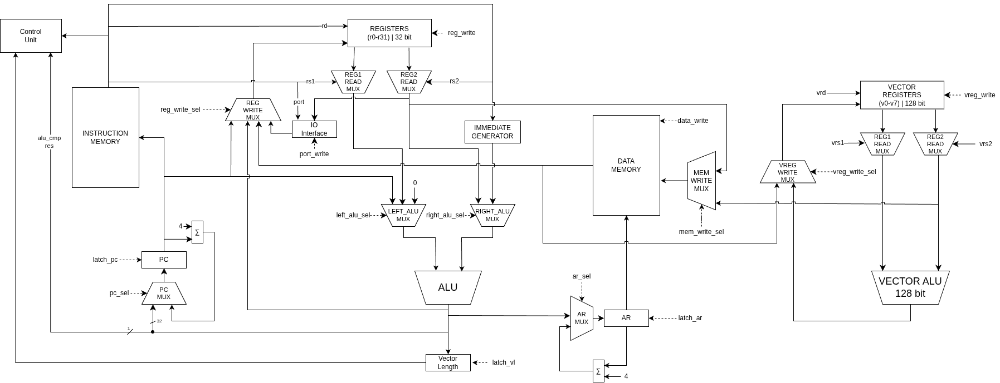

# Meow. Транслятор и модель

<!-- markdown-toc start - Don't edit this section. Run M-x markdown-toc-refresh-toc -->

**Table of Contents**

- [Meow. Транслятор и модель](#meow-транслятор-и-модель)
  - [Язык программирования](#язык-программирования)
  - [Язык программирования Asm](#язык-программирования-asm)
  - [Организация памяти](#организация-памяти)
  - [Система команд](#система-команд)
    - [Набор инструкций](#набор-инструкций)
    - [Кодирование инструкций](#кодирование-инструкций)
      - [Бинарное представление](#бинарное-представление)
  - [Транслятор](#транслятор)
  - [Модель процессора](#модель-процессора)
    - [DataPath](#datapath)
    - [ControlUnit](#controlunit)
  - [Тестирование](#тестирование)
- [Footnotes](#footnotes)

<!-- markdown-toc end -->

---

- Преподаватель: Пенской Александр Владимирович.
- Выполнил: Горелов Илья Александрович, P3231
- `alg | risc | harv | mc | stream | port | cstr | vector | alg1`

## Язык программирования

```ebnf
program             = { top_level_statement }

top_level_statement = comment
                    | declaration
                    | function
                    | const_declaration
                    | while_statement
                    | if_statement
                    | continue_statement
                    | break_statement
                    | return_statement
                    | output_statement
                    | call_statement
                    | assignment
                    | int128_statement

declaration         = type identifier "=" initializer ";"

const_declaration   = "const" type identifier "=" initializer ";"

type                = primitive_type
                    | array_type

primitive_type      = "int"
                    | "int128"
                    | "long"
                    | "byte"
                    | "string"
                    | "bool"

array_type          = array_element_type "[]"

array_element_type  = "int"
                    | "long"
                    | "byte"
                    | "bool"

function            = return_type identifier "("[ parameter_list ]")" block

return_type         = type | "void"

parameter_list      = parameter { "," parameter }

parameter           = type identifier

block               = "{" { body_statement } "}"

body_statement      = comment
                    | declaration
                    | const_declaration
                    | assignment
                    | call_statement
                    | while_statement
                    | if_statement
                    | continue_statement
                    | break_statement
                    | return_statement
                    | output_statement
                    | int128_statement

assignment          = lvalue "=" initializer ";"

lvalue              = identifier [ "[" expression "]" ]

call_statement     = function_call ";"

return_statement   = "return" [ expression ] ";"

output_statement   = "meow" "(" expression ")" ";"

continue_statement = "continue" ";"

break_statement    = "break" ";"

while_statement     = "while" "(" expression ")" block ;

if_statement        = "if", "(" expression ")"
                      block
                      [ "else" block ] ;

initializer         = expression
                    | array_creation
                    | array_literal

array_creation      = "new" array_element_type
                      "[" expression "]"

array_literal       = "{" expression { "," expression } "}"


expression          = logical_or ;

logical_or          = logical_and { "||" logical_and }

logical_and         = bitwise_or { "&&" bitwise_or }

bitwise_or          = bitwise_and { "|" bitwise_and }

bitwise_and         = equality { "&" equality }

equality            = comparison
                      { ("==" | "!=") comparison }

comparison          = additive
                      { ("<" | ">" | "<=" | ">=") additive }

additive            = multiplicative
                      { ("+" | "-") multiplicative }

multiplicative      = unary,
                      { ("*" | "/" | "%") unary }

unary               = "-" unary
                    | postfix

postfix             = primary { "[" expression "]" }

primary             = number_literal
                    | string_literal
                    | char_literal
                    | bool_literal
                    | variable
                    | function_call
                    | input_call
                    | "(" expression ")"

variable            = identifier

function_call       = identifier
                      "(" [ argument_list ] ")"

argument_list       = expression { "," expression }

input_call          = "hear" "()"

number_literal      = decimal_integer
                    | hexadecimal_integer
                    | binary_integer
                    | octal_integer

string_literal      = '"' { string_character } '"'

char_literal        = "'" character "'"

bool_literal        = "true" | "false"

comment             = COMMENT

int128_statement    = "int128" "." "setLength",
                      "(" expression ")" ";"
```

Примечания:

- Создание массива с помощью `int[] array = new int[param]` ожидает в качестве параметра только численный или символьный литерал.
- Создание массива с помощью `int[] array = {param1,param2,...}` ожидает в качестве параметров только численные или символьные литерал.
- `int128.setLength(param)` задает количество элементов вектора, с которыми происходят операции.
- `int128.setLength(param)` ожидает в качестве параметра только численный литерал от 1 до 4.
- Вектор можно создать двумя способами:
  - указать элементы сразу: `int128 vec = {1,1,1,1};` или даже так `int128 vec = "abcd";`
  - либо установить значение с помощью вспомогательного массива:
    - ```meow
         int[] data = {1,1,1,1};
         int128 vec = data[0]; # возьмет 4 элемента, начиная с индекса 0
      ```

Порядок вычисления выражений

- Выражения вычисляются слева направо.
- Для бинарных операторов сначала вычисляется левый операнд, затем правый.

Вызовы функций

- Вычисляются аргументы функции слева направо. Каждый аргумент кладется в регистр a(0-7) последовательно.
- Выполняется тело функции.
- При встрече return функция возвращает результат вызывающему коду в регистрах a(0-1)

Области видимости:

- глобальная. Переменные, объявленные тут, сохраняются в глобальной памяти.
- область видимости функции. Переменные, объявленные тут сохраняются на стеке (за исключением массивов, которые всегда хранятся в глобальной памяти). После возврата из функции стек возвращается в исходной состояние.

Типизация -- статическая

Типы:

- `int` -- целое число (32 бита)
- `long` -- целое число (64 бита)
- `byte` -- целое число (8 бит)
- `bool` -- целое число (8 бит), всегда хранит либо 0, либо 1
- `string` -- строка, на уровне парсера преобразуется в массив `byte[]`
- `int128` -- 128-битный вектор, состоящий из `int`

Виды литералов:

| Вид        | Примеры                 |
| ---------- | ----------------------- |
| Числовые   | `123`, `0x234`, `0b111` |
| Строковые  | `"string" `             |
| Символьные | `'s'`, `'\n'`           |
| Логические | `true`, `false`         |

Примечания:

- все литералы либо на этапе лексера, либо на этапе парсера представляются как численные литералы.

## Организация памяти

```
       Registers
+----------------------------------------------+
| x0 (zero) - zero                             |
| x1 (ra) - return address for a call          |
| x2 (sp) - stack pointer                      |
| x3 (gb) - global pointer                     |
| x4 (tp) - thread pointer                     |
| x5-x7 (t0-t2) - temporary registers          |
| x8-x9 (s0-s1) - callee-saved registers       |
| x10-x17 (a0-a7) - argument registers         |
| x18-x27 (s2-s11) - callee-saved registers    |
| x28-x31 (t3-t6) - temporary registers        |
| pc                                           |
+----------------------------------------------+

       Vector Registers
+-----------------------------------+
| v0-v7                             |
+-----------------------------------+

       Instruction memory
+------------------------------+
| 0   : program start          |
|    ...                       |
|    ...                       |
+------------------------------+

       Data Memory
+------------------------------+
| 00 : constant / variable     |
| 01 : array                   |
| 02 : vector                  |
|    ...                       |
|                              |
|    Stack                     |
|    ...                       |
| s-12: function variable      |
| s-8: saved register          |
| s-4: return address          |
| s+0: stack pointer           |
|                              |
+------------------------------+
```

Память команд:

- Машинное слово 32 бита.
- Все команды записываются в память последовательно
- Функции записываются в память после основной программы, т.е. после `HALT`
- Если инструкция использует относительную адресацию, то трансляция происходит в 2 этапа:
  - сохраняются адреса меток
  - вычисляются смещения

Память данных:

- Машинное слово 32 бита.
- Все данные записываются в память последовательно в соответствии с появлением соотвествующих им переменных в коде

1. Работа с литералами

- Непосредственная адресация может быть использована только в заранее определенных Immediate инструкциях
- Литералы, используемые для инициализации глобальных переменных и массивов, могут сохраняться непосредственно в статической памяти
- Литералы размещаются в памяти в соответствии с заранее определеным транслятором типом (long, int, byte)
- Если литерал выходит за размер машинного слова, то он будет сохранен как Big-endian

2. Работа с константами

- Константы размещаются в памяти также, как и обычные переменные. Однако им уже нельзя присвоить новое значение

3. Работа с переменными

- Статическая память: глобальные переменные размещаются в секции данных. Их адрес известен на этапе компиляции.
- Стек: локальные переменные функций размещаются в стековом кадре. Для доступа к ним используются смещения относительно указателя кадра s0 или указателя стека sp.
- Регистры: во время вычислений значения переменных загружаются в регистры общего назначения. Для этого используются инструкции lw и lb.
- Для сохранения значений из регистров в память используются инструкции sw и sb.
- Если регистров недостаточно для одновременного хранения всех необходимых значений, временные значения сохраняются в стеке, а затем при необходимости загружаются обратно.
- Массивы размещаются в памяти, а переменная массива хранит адрес его первого элемента. Для доступа к элементам вычисляется адрес нужного элемента.
- Переменные типа long занимают два 32-битных слова и при загрузке или сохранении обрабатываются как пара слов.

4. Работа с инструкциями

- Инструкции сохраняются в отдельную память.
- Каждая инструкция занимает 4 байта.
- Ассемблер преобразует мнемоники инструкций в машинные коды.
- Во время выполнения процессор считывает инструкцию по адресу, заданному счётчиком команд PC, декодирует её и выполняет соответствующую операцию.
- Переходы и вызовы процедур изменяют значение PC.

5. Работа с процедурами

- Вызов процедуры осуществляется инструкцией jal, которая сохраняет адрес возврата в регистре ra и передаёт управление процедуре.

- Аргументы передаются через регистры a0–a7

- Возвращаемое значение передаётся через регистр a0. Для типа long, занимающего два машинных слова, используются два регистра.

- При входе в процедуру создаётся стековый кадр, в котором размещаются локальные переменные и сохраняются необходимые регистры.

- Адрес возврата ra и указатель предыдущего кадра s0 сохраняются в стеке, чтобы их значения не потерялись при выполнении процедуры.

- При завершении процедуры восстанавливаются сохранённые регистры и указатель стека. Возврат к вызывающему коду осуществляется через jalr.

## Система команд

Особенности процессора:

- Машинные слова для инструкций и данных - 32 бита
- Доступ к памяти данных осуществляется по адресу, хранящемуся в специальном регистре `AR`. Установка адреса осуществляется путём чтения адреса из указанного регистра с добавлением сдвига.
- Для работы с непосредственными значениями предоставляются специальные директивы:
  - %hi(symbol) - получить старшие 20 бит
  - %lo(symbol) - получить младшие 12 бит
- Обработка данных осуществляется по текущему адресу арифметическими операциями, а также через ввод/вывод.
- Ввод-вывод осуществляется при помощи специальных команд `IN`, `OUT`.
- Ввод-вывод осуществляется как поток токенов
- Поток управления:
  - инкремент `PC` после каждой инструкции;
  - условные и безусловные переходы.

### Набор инструкций

#### Register-Immediate Instructions & jalr (I-type)

| OPCODE  | funct3 | Инструкция                 | Кол-во тактов | Описание                                      |
| :-----: | :----: | -------------------------- | ------------- | --------------------------------------------- |
| 0000001 |  000   | `addi <rd>, <rs1>, <imm>`  | 1             | `rd = rs1 + imm`                              |
| 0000001 |  001   | `slti <rd>, <rs1>, <imm>`  | 1             | `rd = (rs1 < imm) ? 1 : 0`                    |
| 0000001 |  010   | `sltiu <rd>, <rs1>, <imm>` | 1             | works like `slti`, but comparison is unsigned |
| 0000001 |  011   | `xori <rd>, <rs1>, <imm>`  | 1             | `rd = rs1 xor imm`                            |
|    -    |   -    | `mv <rd>, <rs1>`           | 1             | `addi <rd>, <rs1>, 0`                         |
| 0000101 |   -    | `jalr rd, offset(rs1)`     | 1             | 1. `rd = pc` 2. `pc=rs1 + offset`             |

#### Load Upper Immediate & Halt (U-type)

| OPCODE  | Инструкция        | Кол-во тактов | Описание                                          |
| :-----: | ----------------- | ------------- | ------------------------------------------------- |
| 0000010 | `lui <rd>, <imm>` | 1             | loads 20-bit immediate into upper 20 bits of `rd` |
| 0001011 | `halt`            | 1             |                                                   |

#### Register-Register Instructions (R-type)

| OPCODE  | funct3 | funct7  | Инструкция          | Кол-во тактов | Описание                               |
| :-----: | :----: | :-----: | ------------------- | ------------- | -------------------------------------- |
| 0000011 |  000   | 0000000 | `add rd, rs1, rs2`  | 1             | `rd = rs1 + rs2`                       |
| 0000011 |  001   | 0000000 | `sub rd, rs1, rs2`  | 1             | `rd = rs1 - rs2`                       |
| 0000011 |  010   | 0000000 | `slt rd, rs1, rs2`  | 1             | `rd = rs1 < rs2 ? 1 : 0`               |
| 0000011 |  011   | 0000000 | `sltu rd, rs1, rs2` | 1             | like `slt`, but comparison is unsigned |
| 0000011 |  100   | 0000000 | `and rd, rs1, rs2`  | 1             | `rd = rs1 & rs2`                       |
| 0000011 |  101   | 0000000 | `or rd, rs1, rs2`   | 1             | `rd = rs1 \| rs2`                      |
| 0000011 |  110   | 0000000 | `xor rd, rs1, rs2`  | 1             | `rd = rs1 XOR rs2`                     |
| 0000011 |  111   | 0000000 | `sll rd, rs1, rs2`  | 1             | `rd = rs1 << rs2[4:0]` (logical)       |
| 0000011 |  001   | 0000001 | `srl rd, rs1, rs2`  | 1             | `rd = rs1 >> rs2[4:0]` (logical)       |
| 0000011 |  010   | 0000001 | `sra rd, rs1, rs2`  | 1             | `rd = rs1 >> rs2[4:0]` (arithmetic)    |
| 0000011 |  011   | 0000001 | `mul rd, rs1, rs2`  | 1             | `rd = (rs1 * rs2)[31:0]`               |
| 0000011 |  100   | 0000001 | `mulh rd, rs1, rs2` | 1             | `rd = (rs1 * rs2)[63:32]`              |
| 0000011 |  101   | 0000001 | `div rd, rs1, rs2`  | 1             | `rd = rs1 / rs2`                       |
| 0000011 |  110   | 0000001 | `rem rd, rs1, rs2`  | 1             | `rd = rs1 % rs2`                       |

#### Jumps (J-type)

| OPCODE  | Инструкция        | Кол-во тактов | Описание                  |
| ------- | ----------------- | ------------- | ------------------------- |
| 0000100 | `jal <rd>, <imm>` | 1             | 1. `rd = pc` 2. `pc+=imm` |
| 0000100 | `j <imm>`         | 1             | `jal <zero>, <imm>`       |

#### Branches (B-type)

| OPCODE  | funct3 | Инструкция NOP           | Кол-во тактов | Описание                                      |
| :-----: | :----: | ------------------------ | ------------- | --------------------------------------------- |
| 0000110 |  000   | `blt <rs1>, <rs2>, <k>`  | 2             | Branch to `pc + k`, if `rs1 < rs2`            |
| 0000110 |  001   | `bge <rs1>, <rs2>, <k>`  | 2             | Branch to `pc + k`, if `rs1 >= rs2`           |
| 0000110 |  010   | `beq <rs1>, <rs2>, <k>`  | 2             | Branch to `pc + k`, if `rs1 == rs2`           |
| 0000110 |  011   | `bne <rs1>, <rs2>, <k>`  | 2             | Branch to `pc + k`, if `rs1 != rs2`           |
| 0000110 |  100   | `bltu <rs1>, <rs2>, <k>` | 2             | Branch to `pc + k`, if `rs1 < rs2` (unsigned) |

#### Store (S-type)

| OPCODE  | funct3 | Инструкция                  | Кол-во тактов | Описание                                   |
| :-----: | :----: | --------------------------- | ------------- | ------------------------------------------ |
| 0001000 |  000   | `sw <rs2>, <offset>(<rs1>)` | 2             | stores a 32-bit value from rs2 into memory |
| 0001000 |  001   | `sb <rs2>, <offset>(<rs1>)` | 2             | stores a 8-bit value from rs2 into memory  |

#### Load (I-type)

| OPCODE  | funct3 | Инструкция                 | Кол-во тактов | Описание                                 |
| :-----: | :----: | -------------------------- | ------------- | ---------------------------------------- |
| 0000111 |  000   | `lw <rd>, <offset>(<rs1>)` | 2             | loads a 32-bit value from memory into rd |
| 0000111 |  001   | `lb <rd>, <offset>(<rs1>)` | 2             | loads a 8-bit value from memory into rd  |

#### Input (I-type) and Output (S-type)

| OPCODE  | Инструкция NOP      | Кол-во тактов | Описание                           |
| :-----: | ------------------- | ------------- | ---------------------------------- |
| 0001001 | `in <rd>, <port>`   | 1             | Get 32-bit value from port address |
| 0001010 | `out <rs2>, <port>` | 1             |                                    |

#### Vector-to-Vector (R-type)

| OPCODE  | funct3 | funct7 | Инструкция                   | Кол-во тактов | Описание |
| :-----: | :----: | :----: | ---------------------------- | ------------- | -------- |
| 0001100 |  000   |   -    | `vadd <vrd>, <vrs1>, <vrs2>` | 1             |          |
| 0001100 |  001   |   -    | `vsub <vrd>, <vrs1>, <vrs2>` | 1             |          |
| 0001100 |  010   |   -    | `vmul <vrd>, <vrs1>, <vrs2>` | 1             |          |
| 0001100 |  011   |   -    | `vdiv <vrd>, <vrs1>, <vrs2>` | 1             |          |
| 0001100 |  100   |   -    | `vslt <vrd>, <vrs1>, <vrs2>` | 1             |          |

#### Vector Store (S-type)

| OPCODE  | funct3 | Инструкция                       | Кол-во тактов | Описание |
| :-----: | :----: | -------------------------------- | ------------- | -------- |
| 0001101 |  000   | `vstore <vrs2>, <offset>(<rs1>)` | 1             |          |

#### Vector Load (I-type)

| OPCODE  | funct3 | Инструкция                     | Кол-во тактов | Описание |
| :-----: | :----: | ------------------------------ | ------------- | -------- |
| 0001110 |  000   | `vload <vrd>, <offset>(<rs1>)` | 1             |          |

#### Set Vector Length (I-type)

| OPCODE | funct3 | Инструкция           | Кол-во тактов | Описание                                                                                              |
| :----: | :----: | -------------------- | ------------- | ----------------------------------------------------------------------------------------------------- |
| 01111  |  000   | `vsetvl <rd>, <imm>` | 1             | Установить число векторных элементов, с которыми будут производиться операции (в данной модели max=4) |

### Кодирование инструкций

#### Бинарное представление

| Type |  31 – 25   |  24 – 20   |  19 – 15   |  14 – 12   |  11 – 7  | 6 – 0  |
| :--: | :--------: | :--------: | :--------: | :--------: | :------: | :----: |
|  I   | imm[11:5]  |  imm[4:0]  |    rs1     |   funct3   |    rd    | opcode |
|  U   | imm[31:25] | imm[24:20] | imm[19:15] | imm[14:12] |    rd    | opcode |
|  R   |   funct7   |    rs2     |    rs1     |   funct3   |    rd    | opcode |
|  J   | imm[20:14] | imm[13:9]  |  imm[8:4]  |  imm[3:1]  |    rd    | opcode |
|  B   | imm[10:5]  |    rs2     |    rs1     |   funct3   | imm[4:1] | opcode |
|  S   | imm[11:5]  |    rs2     |    rs1     |   funct3   | imm[4:0] | opcode |

## Транслятор

Интерфейс командной строки: `translator.py <input_file> <target_file>`

Реализовано в модуле: [translator](./translator.py)

Этапы трансляции (функция `translate`):

1. Трансформирование текста в последовательность значимых термов.
2. Проверка корректности программы (парность квадратных скобок).
3. Генерация машинного кода.

Правила генерации машинного кода:

- один символ языка -- одна инструкция;
- для команд, однозначно соответствующих инструкциям, -- прямое отображение;
- для циклов с соблюдением парности (многоточие -- произвольный код):

  | Номер команды/инструкции | Программа | Машинный код |
  | :----------------------- | :-------- | :----------- |
  | n                        | `[`       | `JZ (k+1)`   |
  | ...                      | ...       | ...          |
  | k                        | `]`       | `JMP n`      |
  | k+1                      | ...       | ...          |

Примечание: вопросы отображения переменных на регистры опущены из-за отсутствия оных.

## Модель процессора

Интерфейс командной строки: `machine.py <machine_code_file> <input_file>`

Реализовано в модуле: [machine](./machine.py).

### DataPath

TODO: распистаь какой reg1 это rs1, rs2, rd


Реализован в классе `DataPath`.

`data_memory` -- однопортовая память, поэтому либо читаем, либо пишем.

Сигналы (обрабатываются за один такт, реализованы в виде методов класса):

- `latch_data_addr` -- защёлкнуть выбранное значение в `data_addr`;
- `latch_acc` -- защёлкнуть в аккумулятор выход памяти данных;
- `wr` -- записать выбранное значение в память:
  - инкрементированное;
  - декрементированное;
  - с порта ввода `input` (обработка на Python):
    - извлечь из входного буфера значение и записать в память;
    - если буфер пуст -- выбросить исключение;
- `output` -- записать аккумулятор в порт вывода (обработка на Python).

Флаги:

- `zero` -- отражает наличие нулевого значения в аккумуляторе.

### ControlUnit


Реализован в классе `ControlUnit`.

- Microcoded (реализовано полностью на Python).
- Метод `process_next_tick` моделирует выполнение полного цикла инструкции (1-2 такта процессора).
- `step_counter` необходим для многотактовых инструкций;
  - в реализации класса `ControlUnit` отсутствует, т.к. неявно задан потоком управления.

Сигнал:

- `latch_program_counter` -- сигнал для обновления счётчика команд в ControlUnit.

Особенности работы модели:

- Цикл симуляции осуществляется в функции `simulation`.
- Шаг моделирования соответствует одной инструкции с выводом состояния в журнал.
- Для журнала состояний процессора используется стандартный модуль `logging`.
- Количество инструкций для моделирования лимитировано.
- Остановка моделирования осуществляется при:
  - превышении лимита количества выполняемых инструкций;
  - исключении `EOFError` -- если нет данных для чтения из порта ввода;
  - исключении `StopIteration` -- если выполнена инструкция `halt`.

### Бинарное представление микроинструкции

Подробнее в [microcode_mem.py](src/microcode_mem.py)

| Bit Number | Description    | Possible Values |
| :--------: | -------------- | :-------------: |
|    1-4     | ALU operation  |  \[0000;1110]   |
|    5-6     | ALU LEFT MUX   |    \[00;11]     |
|    7-8     | ALU RIGHT MUX  |    \[00;10]     |
|    9-11    | REG WRITE MUX  |   \[000;101]    |
|   12-13    | MEM WRITE MUX  |    \[00;11]     |
|   14-15    | AR MUX         |    \[00;10]     |
|     16     | LATCH AR       |     \[0;1]      |
|   17-18    | PC MUX         |    \[00;10]     |
|     19     | LATCH PC       |     \[0;1]      |
|     20     | REG WRITE      |     \[0;1]      |
|     21     | PORT WRITE     |     \[0;1]      |
|     22     | DATA WRITE     |     \[0;1]      |
|     23     | LATCH mPC      |     \[0;1]      |
|   24-25    | mPC MUX        |    \[00;11]     |
|   26-28    | VALU operation |   \[000;101]    |
|   29-30    | VREG WRITE MUX |    \[00;10]     |
|     31     | VREG WRITE     |     \[0;1]      |
|     32     | Latch VL       |     \[0;1]      |
|   33-35    | Vector Lane    |   \[000;100]    |
|     36     | Halt           |     \[0;1]      |
|   37-38    | Condition      |    \[00;10]     |

## Тестирование

Тестирование выполняется при помощи golden test-ов.

1. Тесты для языка `bf` реализованы в: [golden_bf_test.py](./golden_bf_test.py). Конфигурации:
   - [golden/cat_bf.yml](golden/cat_bf.yml)
   - [golden/hello_bf.yml](golden/hello_bf.yml)
1. Тесты для языка `asm` реализованы в: [golden_asm_test.py](./golden_asm_test.py). Конфигурации:
   - [golden/cat_asm.yml](golden/cat_asm.yml)

Запустить тесты: `poetry run pytest . -v`

Обновить конфигурацию golden tests: `poetry run pytest . -v --update-goldens`

Пример использования транслятора (бинарное и json представление машинного кода):

```shell
$ cd brainfuck/python
$ cat examples/cat.bf
,[.,]
$ ./translator.py examples/cat.bf out/target.bin
source LoC: 2 code instr: 6
$ xxd out/target.bin
00000000: 5000 0000 7000 0005 4000 0000 5000 0000  P...p...@...P...
00000010: 6000 0001 8000 0000                      `.......
$ cat out/target.bin.hex
0 - 50000000 - input
1 - 70000005 - jz 5
2 - 40000000 - print
3 - 50000000 - input
4 - 60000001 - jmp 1
5 - 80000000 - halt⏎
$ ./translator.py examples/cat.bf out/target.json
source LoC: 2 code instr: 6
$ cat out/target.json
[{"index": 0, "opcode": "input", "term": [1, 1, ","]},
 {"index": 4, "opcode": "jz", "arg": 5, "term": [1, 2, "["]},
 {"index": 2, "opcode": "print", "term": [1, 3, "."]},
 {"index": 3, "opcode": "input", "term": [1, 4, ","]},
 {"index": 4, "opcode": "jmp", "arg": 1, "term": [1, 5, "]"]},
 {"index": 5, "opcode": "halt"}]⏎
```

Пример использования модели процессора:

```shell
$ cat examples/foo_input.txt
foo
$ ./machine.py out/target.bin examples/foo_input.txt
DEBUG:root:TICK:   0 PC:   0/0 ADDR:   0 MEM_OUT: 0 ACC: 0 	input [50000000]
DEBUG:root:TICK:   1 PC:   0/1 ADDR:   0 MEM_OUT: 0 ACC: 0 	input [50000000]
DEBUG:root:input: 'f'
DEBUG:root:TICK:   2 PC:   1/0 ADDR:   0 MEM_OUT: 102 ACC: 0 	jz 5 [70000005]
DEBUG:root:TICK:   3 PC:   1/1 ADDR:   0 MEM_OUT: 102 ACC: 102 	jz 5 [70000005]
DEBUG:root:TICK:   4 PC:   2/0 ADDR:   0 MEM_OUT: 102 ACC: 102 	print [40000000]
DEBUG:root:TICK:   5 PC:   2/1 ADDR:   0 MEM_OUT: 102 ACC: 102 	print [40000000]
DEBUG:root:output: '' << 'f'
DEBUG:root:TICK:   6 PC:   3/0 ADDR:   0 MEM_OUT: 102 ACC: 102 	input [50000000]
DEBUG:root:TICK:   7 PC:   3/1 ADDR:   0 MEM_OUT: 102 ACC: 102 	input [50000000]
DEBUG:root:input: 'o'
DEBUG:root:TICK:   8 PC:   4/0 ADDR:   0 MEM_OUT: 111 ACC: 102 	jmp 1 [60000001]
DEBUG:root:TICK:   9 PC:   1/0 ADDR:   0 MEM_OUT: 111 ACC: 102 	jz 5 [70000005]
DEBUG:root:TICK:  10 PC:   1/1 ADDR:   0 MEM_OUT: 111 ACC: 111 	jz 5 [70000005]
DEBUG:root:TICK:  11 PC:   2/0 ADDR:   0 MEM_OUT: 111 ACC: 111 	print [40000000]
DEBUG:root:TICK:  12 PC:   2/1 ADDR:   0 MEM_OUT: 111 ACC: 111 	print [40000000]
DEBUG:root:output: 'f' << 'o'
DEBUG:root:TICK:  13 PC:   3/0 ADDR:   0 MEM_OUT: 111 ACC: 111 	input [50000000]
DEBUG:root:TICK:  14 PC:   3/1 ADDR:   0 MEM_OUT: 111 ACC: 111 	input [50000000]
DEBUG:root:input: 'o'
DEBUG:root:TICK:  15 PC:   4/0 ADDR:   0 MEM_OUT: 111 ACC: 111 	jmp 1 [60000001]
DEBUG:root:TICK:  16 PC:   1/0 ADDR:   0 MEM_OUT: 111 ACC: 111 	jz 5 [70000005]
DEBUG:root:TICK:  17 PC:   1/1 ADDR:   0 MEM_OUT: 111 ACC: 111 	jz 5 [70000005]
DEBUG:root:TICK:  18 PC:   2/0 ADDR:   0 MEM_OUT: 111 ACC: 111 	print [40000000]
DEBUG:root:TICK:  19 PC:   2/1 ADDR:   0 MEM_OUT: 111 ACC: 111 	print [40000000]
DEBUG:root:output: 'fo' << 'o'
DEBUG:root:TICK:  20 PC:   3/0 ADDR:   0 MEM_OUT: 111 ACC: 111 	input [50000000]
DEBUG:root:TICK:  21 PC:   3/1 ADDR:   0 MEM_OUT: 111 ACC: 111 	input [50000000]
DEBUG:root:input: '\n'
DEBUG:root:TICK:  22 PC:   4/0 ADDR:   0 MEM_OUT: 10 ACC: 111 	jmp 1 [60000001]
DEBUG:root:TICK:  23 PC:   1/0 ADDR:   0 MEM_OUT: 10 ACC: 111 	jz 5 [70000005]
DEBUG:root:TICK:  24 PC:   1/1 ADDR:   0 MEM_OUT: 10 ACC: 10 	jz 5 [70000005]
DEBUG:root:TICK:  25 PC:   2/0 ADDR:   0 MEM_OUT: 10 ACC: 10 	print [40000000]
DEBUG:root:TICK:  26 PC:   2/1 ADDR:   0 MEM_OUT: 10 ACC: 10 	print [40000000]
DEBUG:root:output: 'foo' << '\n'
DEBUG:root:TICK:  27 PC:   3/0 ADDR:   0 MEM_OUT: 10 ACC: 10 	input [50000000]
DEBUG:root:TICK:  28 PC:   3/1 ADDR:   0 MEM_OUT: 10 ACC: 10 	input [50000000]
WARNING:root:Input buffer is empty!
INFO:root:output_buffer: 'foo\n'
foo

ticks: 28
```
