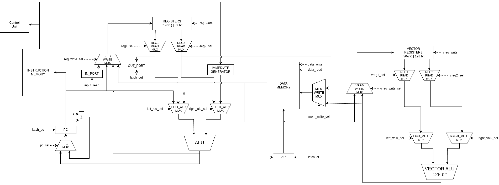
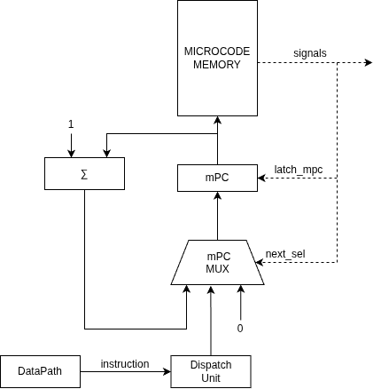

# Meow. Транслятор и модель

<!-- markdown-toc start - Don't edit this section. Run M-x markdown-toc-refresh-toc -->

**Table of Contents**

- [Meow. Транслятор и модель](#meow-транслятор-и-модель)
  - [Язык программирования](#язык-программирования)
  - [Язык программирования Asm](#язык-программирования-asm)
  - [Организация памяти](#организация-памяти)
  - [Система команд](#система-команд)
    - [Набор инструкций](#набор-инструкций)
    - [Кодирование инструкций](#кодирование-инструкций)
      - [Бинарное представление](#бинарное-представление)
  - [Транслятор](#транслятор)
  - [Модель процессора](#модель-процессора)
    - [DataPath](#datapath)
    - [ControlUnit](#controlunit)
  - [Тестирование](#тестирование)
- [Footnotes](#footnotes)

<!-- markdown-toc end -->

---

- Преподаватель: Пенской Александр Владимирович.
- `alg | risc | harv | mc | stream | port | cstr | vector | alg1`

## Язык программирования

```ebnf
<program> ::= <term>*

<term> ::= <var_declaration>
         | <const_declaration>
         | <var_assignment>
         | <function>
         | <cycle>
         | <branch>
         | <comment>
         | <function_call_statement>
         | <output>
         | <continue_statement>
         | <break_statement>
         | <return_statement>


<var_declaration> ::= <type> <name> = <initializer> ;

<type> ::= <primitive_type>
         | <array_type>

<primitive_type> ::= int
                   | long
                   | byte
                   | bool
                   | string

<array_type> ::= int []
               | long []
               | byte []

<name> ::= <letter_or_digit_or_underscore>

<initializer> ::= <expression>
                | <array_creation>

<expression> ::= <logical_or_expression>

<logical_or_expression> ::= <logical_and_expression>
                          | <logical_or_expression> || <logical_and_expression>

<logical_and_expression> ::= <bitwise_or_expression>
                           | <logical_and_expression> && <bitwise_or_expression>

<bitwise_or_expression> ::= <bitwise_and_expression>
                          | <bitwise_or_expression> | <bitwise_and_expression>

<bitwise_and_expression> ::= <equality_expression>
                           | <bitwise_and_expression> & <equality_expression>

<equality_expression> ::= <relational_expression>
                        | <equality_expression> == <relational_expression>
                        | <equality_expression> != <relational_expression>

<relational_expression> ::= <additive_expression>
                          | <relational_expression> < <additive_expression>
                          | <relational_expression> > <additive_expression>
                          | <relational_expression> <= <additive_expression>
                          | <relational_expression> >= <additive_expression>

<additive_expression> ::= <multiplicative_expression>
                        | <additive_expression> + <multiplicative_expression>
                        | <additive_expression> - <multiplicative_expression>

<multiplicative_expression> ::= <unary_expression>
                              | <multiplicative_expression> * <unary_expression>
                              | <multiplicative_expression> / <unary_expression>
                              | <multiplicative_expression> % <unary_expression>

<unary_expression> ::= <postfix_expression>
                     | - <unary_expression>

<postfix_expression> ::= <primary_expression>
                       | <postfix_expression> [ <expression> ]


<primary_expression> ::= <name>
                       | <number_literal>
                       | <boolean_literal>
                       | <string_literal>
                       | <byte_literal>
                       | <input_call>
                       | <function_call>
                       | ( <expression> )

<number_literal> ::= <digit>+

<boolean_literal> ::= true | false

<string_literal> ::= "<any characters except double quotes>"

<byte_literal> ::= '<single character except single quote>'

<input_call> ::= hear ()

<function_call> ::= <name> ( [ <arguments> ] )

<arguments> ::= <expression>
              | <expression> , <arguments>

<array_creation> ::= new <array_element_type> [ <expression> ]

<array_element_type> ::= int
                       | long
                       | byte

<const_declaration> ::= const <var_declaration>

<var_assignment> ::= <lvalue> = <initializer> ;

<lvalue> ::= <name>
           | <name> [ <expression> ]

<function_call_statement> ::= <function_call> ;

<function> ::= <return_type> <name>
               ( <parameters> )
               { <body> }

<return_type> ::= <type>
                | void

<parameters> ::= <empty>
               | <parameter>
               | <parameter> , <parameters>

<parameter> ::= <type> <name>

<body> ::= <body_term>*

<body_term> ::= <var_declaration>
              | <const_declaration>
              | <var_assignment>
              | <cycle>
              | <branch>
              | <comment>
              | <function_call_statement>
              | <output>
              | <continue_statement>
              | <break_statement>
              | <return_statement>


<cycle> ::= while ( <boolean_expression> ) { <body> }

<boolean_expression> ::= <expression>

<branch> ::= if ( <boolean_expression> ) { <body> }
             [ else { <body> } ]

<continue_statement> ::= continue ;

<break_statement> ::= break ;

<return_statement> ::= return [ <expression> ] ;

<output> ::= meow ( <expression> ) ;

<comment> ::= # <characters_except_newline>
```

Код выполняется последовательно.

Стратегия вычислений:
Вызов по значению - аргументы функции вычисляется слева направо, затем связываются с соответствующим формальным параметром функции

Память выделяется статически, при запуске модели. Видимость данных -- локальная.

Типизация -- статическая

Виды литералов:

- long - 8-байтовые знаковые числа;
- int - 4-байтовые знаковые числа;
- string - null-terminated strings;
- byte\bool - однобайтовые знаковые числа;

## Организация памяти

```
       Registers
+----------------------------------------------+
| x0 (zero) - zero                             |
| x1 (ra) - return address for a call          |
| x2 (sp) - stack pointer                      |
| x3 (gb) - global pointer                     |
| x4 (tp) - thread pointer                     |
| x5-x7 (t0-t2) - temporary registers          |
| x8-x9 (s0-s1) - callee-saved registers       |
| x10-x17 (a0-a7) - argument registers         |
| x18-x27 (s2-s11) - callee-saved registers    |
| x28-x31 (t3-t6) - temporary registers        |
| pc                                           |
+----------------------------------------------+

       Vector Registers
+-----------------------------------+
| v0-v7                             |
+-----------------------------------+

       Instruction memory
+------------------------------+
| 0   : program start          |
|    ...                       |
|    ...                       |
+------------------------------+

          Data memory
+------------------------------+
| 00  : constant 1             |
| 01  : constant 2             |
|    ...                       |
| l+0 : num literals           |
| l+1 : num literals           |
|    ...                       |
| c+0 : variable 1             |
|    ...                       |
+------------------------------+
```

1. Работа с литералами

- Непосредственная адресация может быть использована только в операциях `Load Upper Immediate` и `Add Immediate`. Когда литерал используется в арифметических выражениях, либо в условных переходах.
- Сохранение в статическую память происходит только при присвоении переменной значения литерала
- Литералы размещаются последовательно в памяти
- Если литерал выходит за размер машинного слова, то он будет сохранен как Big-endian

2. Работа с константами

- константы размещаются в начале памяти данных, последовательно, в соответсвии с нотацией Big-endian

3. Работа с переменными

- Переменная отображается в регистр только при помощи команд `Load Word` и `Load Byte`, например, при арифметичских операциях и условных переходах
- Если регистров не хватает для переменных, то значение в регистрах может быть либо очищено, если оно не используется дальше в программе, либо отправлено на стек, если оно дальше будет использоваться
- Сохранение переменных в память происходит только при помощи команд `Store Word` и `Store Byte` после завершения арифметической операции
- Переменные отправляются на стек, только когда они лежат в регистрах. Это может произойти, когда регистров не хватает для всех переменных, например, при вычислениях или при передаче аргументов функции

4. Работа с инструкциями

- Инструкции сохраняются в отдельную память.
- Каждая инструкция занимает 4 байта.

5. Работа с процедурами

- Параметры процедуры передаются через регистры + стек
- Результат процедуры возвращается через регистр a1

## Система команд

Особенности процессора:

- Машинные слова для инструкций и данных - 32 бита
- Доступ к памяти данных осуществляется по адресу, хранящемуся в специальном регистре `AR`. Установка адреса осуществляется путём чтения адреса из указанного регистра с добавлением сдвига.
- Для работы с непосредственными значениями предоставляются специальные директивы:
  - %hi(symbol) - получить старшие 20 бит
  - %lo(symbol) - получить младшие 12 бит
- Обработка данных осуществляется по текущему адресу арифметическими операциями, а также через ввод/вывод.
- Ввод-вывод осуществляется при помощи специальных команд `IN`, `OUT`.
- Ввод-вывод осуществляется как поток токенов
- Поток управления:
  - инкремент `PC` после каждой инструкции;
  - условные и безусловные переходы.

### Набор инструкций

#### Register-Immediate Instructions & jalr & lw & lb (I-type)

| OPCODE | funct3 | Инструкция                 | Кол-во тактов | Описание                                      |
| :----: | :----: | -------------------------- | ------------- | --------------------------------------------- |
| 00001  |  000   | `addi <rd>, <rs1>, <imm>`  | 1             | `rd = rs1 + imm`                              |
| 00001  |  001   | `slti <rd>, <rs1>, <imm>`  | 1             | `rd = (rs1 < imm) ? 1 : 0`                    |
| 00001  |  010   | `sltiu <rd>, <rs1>, <imm>` | 1             | works like `slti`, but comparison is unsigned |
| 00001  |  011   | `xori <rd>, <rs1>, <imm>`  | 1             | `rd = rs1 xor imm`                            |
| 00001  |  000   | `mv <rd>, <rs>`            | 1             | `addi <rd>, <rs1>, 0`                         |
| 00101  |   -    | `jalr rd, offset(rs1)`     | 1             | 1. `rd = pc` 2. `pc=rs1 + offset`             |
| 00111  |  000   | `lw <rd>, <offset>(<rs1>)` | 2             | loads a 32-bit value from memory into rd      |
| 00111  |  001   | `lb <rd>, <offset>(<rs1>)` | 2             | loads a 8-bit value from memory into rd       |

#### Load Upper Immediate & Halt (U-type)

| OPCODE | Инструкция        | Кол-во тактов | Описание                                          |
| :----: | ----------------- | ------------- | ------------------------------------------------- |
| 00010  | `lui <rd>, <imm>` | 1             | loads 20-bit immediate into upper 20 bits of `rd` |
| 01011  | `halt`            | 1             |                                                   |

#### Register-Register Instructions (R-type)

| OPCODE | funct3 | funct7  | Инструкция          | Кол-во тактов | Описание                               |
| :----: | :----: | :-----: | ------------------- | ------------- | -------------------------------------- |
| 00011  |  000   | 0000000 | `add rd, rs1, rs2`  | 1             | `rd = rs1 + rs2`                       |
| 00011  |  001   | 0000000 | `sub rd, rs1, rs2`  | 1             | `rd = rs1 - rs2`                       |
| 00011  |  010   | 0000000 | `slt rd, rs1, rs2`  | 1             | `rd = rs1 < rs2 ? 1 : 0`               |
| 00011  |  011   | 0000000 | `sltu rd, rs1, rs2` | 1             | like `slt`, but comparison is unsigned |
| 00011  |  100   | 0000000 | `and rd, rs1, rs2`  | 1             | `rd = rs1 & rs2`                       |
| 00011  |  101   | 0000000 | `or rd, rs1, rs2`   | 1             | `rd = rs1 \| rs2`                      |
| 00011  |  110   | 0000000 | `xor rd, rs1, rs2`  | 1             | `rd = rs1 XOR rs2`                     |
| 00011  |  111   | 0000000 | `sll rd, rs1, rs2`  | 1             | `rd = rs1 << rs2[4:0]` (logical)       |
| 00011  |  001   | 0000001 | `srl rd, rs1, rs2`  | 1             | `rd = rs1 >> rs2[4:0]` (logical)       |
| 00011  |  010   | 0000001 | `sra rd, rs1, rs2`  | 1             | `rd = rs1 >> rs2[4:0]` (arithmetic)    |
| 00011  |  011   | 0000001 | `mul rd, rs1, rs2`  | 1             | `rd = (rs1 * rs2)[31:0]`               |
| 00011  |  100   | 0000001 | `mulh rd, rs1, rs2` | 1             | `rd = (rs1 * rs2)[63:32]`              |
| 00011  |  101   | 0000001 | `div rd, rs1, rs2`  | 1             | `rd = rs1 / rs2`                       |
| 00011  |  110   | 0000001 | `rem rd, rs1, rs2`  | 1             | `rd = rs1 % rs2`                       |

#### Jumps (J-type)

| OPCODE | Инструкция        | Кол-во тактов | Описание                  |
| ------ | ----------------- | ------------- | ------------------------- |
| 00100  | `jal <rd>, <imm>` | 1             | 1. `rd = pc` 2. `pc+=imm` |
| 00100  | `j <imm>`         | 1             | `jal <zero>, <imm>`       |

#### Branches (B-type)

| OPCODE | funct3 | Инструкция NOP           | Кол-во тактов | Описание                                      |
| :----: | :----: | ------------------------ | ------------- | --------------------------------------------- |
| 00110  |  000   | `blt <rs1>, <rs2>, <k>`  | 2             | Branch to `pc + k`, if `rs1 < rs2`            |
| 00110  |  001   | `bge <rs1>, <rs2>, <k>`  | 2             | Branch to `pc + k`, if `rs1 >= rs2`           |
| 00110  |  010   | `beq <rs1>, <rs2>, <k>`  | 2             | Branch to `pc + k`, if `rs1 == rs2`           |
| 00110  |  011   | `bne <rs1>, <rs2>, <k>`  | 2             | Branch to `pc + k`, if `rs1 != rs2`           |
| 00110  |  100   | `bltu <rs1>, <rs2>, <k>` | 2             | Branch to `pc + k`, if `rs1 < rs2` (unsigned) |

#### Store (S-type)

| OPCODE | funct3 | Инструкция                  | Кол-во тактов | Описание                                   |
| :----: | :----: | --------------------------- | ------------- | ------------------------------------------ |
| 01000  |  000   | `sw <rs2>, <offset>(<rs1>)` | 2             | stores a 32-bit value from rs2 into memory |
| 01000  |  001   | `sb <rs2>, <offset>(<rs1>)` | 2             | stores a 8-bit value from rs2 into memory  |

#### IO (U-type)

| OPCODE | Инструкция NOP | Кол-во тактов | Описание |
| :----: | -------------- | ------------- | -------- |
| 01001  | `in <rd>`      | 1             |          |
| 01010  | `out <rd>`     | 1             |          |

#### Vector-to-Vector (R-type)

| OPCODE | funct3 | funct7 | Инструкция                | Кол-во тактов | Описание |
| :----: | :----: | :----: | ------------------------- | ------------- | -------- |
| 01100  |  000   |   -    | `vadd <rd>, <rs1>, <rs2>` | 1             |          |
| 01100  |  001   |   -    | `vsub <rd>, <rs1>, <rs2>` | 1             |          |
| 01100  |  010   |   -    | `vmul <rd>, <rs1>, <rs2>` | 1             |          |
| 01100  |  011   |   -    | `vdiv <rd>, <rs1>, <rs2>` | 1             |          |
| 01100  |  100   |   -    | `vslt <rd>, <rs1>, <rs2>` | 1             |          |

#### Vector Store (VS-type)

| OPCODE | Инструкция                                | Кол-во тактов | Описание |
| :----: | ----------------------------------------- | ------------- | -------- |
| 01101  | `vstore <vrs1>, <offset>(<rs2>), <count>` | 1             |          |

#### Vector Load (VL-type)

| OPCODE | Инструкция                               | Кол-во тактов | Описание |
| :----: | ---------------------------------------- | ------------- | -------- |
| 01110  | `vload <vrd1>, <offset>(<rs2>), <count>` | 1             |          |

### Кодирование инструкций

#### Бинарное представление

| Type |      31 – 25      |  24 – 20   |  19 – 15   |  14 – 12   |  11 – 7  | 6 – 0  |
| :--: | :---------------: | :--------: | :--------: | :--------: | :------: | :----: |
|  I   |     imm[11:5]     |  imm[4:0]  |    rs1     |   funct3   |    rd    | opcode |
|  U   |    imm[31:25]     | imm[24:20] | imm[19:15] | imm[14:12] |    rd    | opcode |
|  R   |      funct7       |    rs2     |    rs1     |   funct3   |    rd    | opcode |
|  J   | imm[20\|10:1\|11] | imm[19:12] |     —      |     —      |    rd    | opcode |
|  B   |     imm[10:5]     |    rs2     |    rs1     |   funct3   | imm[4:1] | opcode |
|  S   |     imm[11:5]     |    rs2     |    rs1     |   funct3   | imm[4:0] | opcode |

##### Vectors

| Type |  31 – 25  | 24 – 20  | 19 – 16 | 15 – 12 |  11 – 7  | 6 – 0  |
| :--: | :-------: | :------: | :-----: | :-----: | :------: | :----: |
|  VS  | imm[11:5] |   rs2    |   rs1   |  count  | imm[4:0] | VSTORE |
|  VL  | imm[11:5] | imm[4:0] |   rs1   |  count  |    rd    | opcode |

## Транслятор

Интерфейс командной строки: `translator.py <input_file> <target_file>`

Реализовано в модуле: [translator](./translator.py)

Этапы трансляции (функция `translate`):

1. Трансформирование текста в последовательность значимых термов.
2. Проверка корректности программы (парность квадратных скобок).
3. Генерация машинного кода.

Правила генерации машинного кода:

- один символ языка -- одна инструкция;
- для команд, однозначно соответствующих инструкциям, -- прямое отображение;
- для циклов с соблюдением парности (многоточие -- произвольный код):

  | Номер команды/инструкции | Программа | Машинный код |
  | :----------------------- | :-------- | :----------- |
  | n                        | `[`       | `JZ (k+1)`   |
  | ...                      | ...       | ...          |
  | k                        | `]`       | `JMP n`      |
  | k+1                      | ...       | ...          |

Примечание: вопросы отображения переменных на регистры опущены из-за отсутствия оных.

## Модель процессора

Интерфейс командной строки: `machine.py <machine_code_file> <input_file>`

Реализовано в модуле: [machine](./machine.py).

### DataPath



Реализован в классе `DataPath`.

`data_memory` -- однопортовая память, поэтому либо читаем, либо пишем.

Сигналы (обрабатываются за один такт, реализованы в виде методов класса):

- `latch_data_addr` -- защёлкнуть выбранное значение в `data_addr`;
- `latch_acc` -- защёлкнуть в аккумулятор выход памяти данных;
- `wr` -- записать выбранное значение в память:
  - инкрементированное;
  - декрементированное;
  - с порта ввода `input` (обработка на Python):
    - извлечь из входного буфера значение и записать в память;
    - если буфер пуст -- выбросить исключение;
- `output` -- записать аккумулятор в порт вывода (обработка на Python).

Флаги:

- `zero` -- отражает наличие нулевого значения в аккумуляторе.

### ControlUnit



Реализован в классе `ControlUnit`.

- Hardwired (реализовано полностью на Python).
- Метод `process_next_tick` моделирует выполнение полного цикла инструкции (1-2 такта процессора).
- `step_counter` необходим для многотактовых инструкций;
  - в реализации класса `ControlUnit` отсутствует, т.к. неявно задан потоком управления.

Сигнал:

- `latch_program_counter` -- сигнал для обновления счётчика команд в ControlUnit.

Особенности работы модели:

- Цикл симуляции осуществляется в функции `simulation`.
- Шаг моделирования соответствует одной инструкции с выводом состояния в журнал.
- Для журнала состояний процессора используется стандартный модуль `logging`.
- Количество инструкций для моделирования лимитировано.
- Остановка моделирования осуществляется при:
  - превышении лимита количества выполняемых инструкций;
  - исключении `EOFError` -- если нет данных для чтения из порта ввода;
  - исключении `StopIteration` -- если выполнена инструкция `halt`.

## Тестирование

Тестирование выполняется при помощи golden test-ов.

1. Тесты для языка `bf` реализованы в: [golden_bf_test.py](./golden_bf_test.py). Конфигурации:
   - [golden/cat_bf.yml](golden/cat_bf.yml)
   - [golden/hello_bf.yml](golden/hello_bf.yml)
1. Тесты для языка `asm` реализованы в: [golden_asm_test.py](./golden_asm_test.py). Конфигурации:
   - [golden/cat_asm.yml](golden/cat_asm.yml)

Запустить тесты: `poetry run pytest . -v`

Обновить конфигурацию golden tests: `poetry run pytest . -v --update-goldens`

Пример использования транслятора (бинарное и json представление машинного кода):

```shell
$ cd brainfuck/python
$ cat examples/cat.bf
,[.,]
$ ./translator.py examples/cat.bf out/target.bin
source LoC: 2 code instr: 6
$ xxd out/target.bin
00000000: 5000 0000 7000 0005 4000 0000 5000 0000  P...p...@...P...
00000010: 6000 0001 8000 0000                      `.......
$ cat out/target.bin.hex
0 - 50000000 - input
1 - 70000005 - jz 5
2 - 40000000 - print
3 - 50000000 - input
4 - 60000001 - jmp 1
5 - 80000000 - halt⏎
$ ./translator.py examples/cat.bf out/target.json
source LoC: 2 code instr: 6
$ cat out/target.json
[{"index": 0, "opcode": "input", "term": [1, 1, ","]},
 {"index": 4, "opcode": "jz", "arg": 5, "term": [1, 2, "["]},
 {"index": 2, "opcode": "print", "term": [1, 3, "."]},
 {"index": 3, "opcode": "input", "term": [1, 4, ","]},
 {"index": 4, "opcode": "jmp", "arg": 1, "term": [1, 5, "]"]},
 {"index": 5, "opcode": "halt"}]⏎
```

Пример использования модели процессора:

```shell
$ cat examples/foo_input.txt
foo
$ ./machine.py out/target.bin examples/foo_input.txt
DEBUG:root:TICK:   0 PC:   0/0 ADDR:   0 MEM_OUT: 0 ACC: 0 	input [50000000]
DEBUG:root:TICK:   1 PC:   0/1 ADDR:   0 MEM_OUT: 0 ACC: 0 	input [50000000]
DEBUG:root:input: 'f'
DEBUG:root:TICK:   2 PC:   1/0 ADDR:   0 MEM_OUT: 102 ACC: 0 	jz 5 [70000005]
DEBUG:root:TICK:   3 PC:   1/1 ADDR:   0 MEM_OUT: 102 ACC: 102 	jz 5 [70000005]
DEBUG:root:TICK:   4 PC:   2/0 ADDR:   0 MEM_OUT: 102 ACC: 102 	print [40000000]
DEBUG:root:TICK:   5 PC:   2/1 ADDR:   0 MEM_OUT: 102 ACC: 102 	print [40000000]
DEBUG:root:output: '' << 'f'
DEBUG:root:TICK:   6 PC:   3/0 ADDR:   0 MEM_OUT: 102 ACC: 102 	input [50000000]
DEBUG:root:TICK:   7 PC:   3/1 ADDR:   0 MEM_OUT: 102 ACC: 102 	input [50000000]
DEBUG:root:input: 'o'
DEBUG:root:TICK:   8 PC:   4/0 ADDR:   0 MEM_OUT: 111 ACC: 102 	jmp 1 [60000001]
DEBUG:root:TICK:   9 PC:   1/0 ADDR:   0 MEM_OUT: 111 ACC: 102 	jz 5 [70000005]
DEBUG:root:TICK:  10 PC:   1/1 ADDR:   0 MEM_OUT: 111 ACC: 111 	jz 5 [70000005]
DEBUG:root:TICK:  11 PC:   2/0 ADDR:   0 MEM_OUT: 111 ACC: 111 	print [40000000]
DEBUG:root:TICK:  12 PC:   2/1 ADDR:   0 MEM_OUT: 111 ACC: 111 	print [40000000]
DEBUG:root:output: 'f' << 'o'
DEBUG:root:TICK:  13 PC:   3/0 ADDR:   0 MEM_OUT: 111 ACC: 111 	input [50000000]
DEBUG:root:TICK:  14 PC:   3/1 ADDR:   0 MEM_OUT: 111 ACC: 111 	input [50000000]
DEBUG:root:input: 'o'
DEBUG:root:TICK:  15 PC:   4/0 ADDR:   0 MEM_OUT: 111 ACC: 111 	jmp 1 [60000001]
DEBUG:root:TICK:  16 PC:   1/0 ADDR:   0 MEM_OUT: 111 ACC: 111 	jz 5 [70000005]
DEBUG:root:TICK:  17 PC:   1/1 ADDR:   0 MEM_OUT: 111 ACC: 111 	jz 5 [70000005]
DEBUG:root:TICK:  18 PC:   2/0 ADDR:   0 MEM_OUT: 111 ACC: 111 	print [40000000]
DEBUG:root:TICK:  19 PC:   2/1 ADDR:   0 MEM_OUT: 111 ACC: 111 	print [40000000]
DEBUG:root:output: 'fo' << 'o'
DEBUG:root:TICK:  20 PC:   3/0 ADDR:   0 MEM_OUT: 111 ACC: 111 	input [50000000]
DEBUG:root:TICK:  21 PC:   3/1 ADDR:   0 MEM_OUT: 111 ACC: 111 	input [50000000]
DEBUG:root:input: '\n'
DEBUG:root:TICK:  22 PC:   4/0 ADDR:   0 MEM_OUT: 10 ACC: 111 	jmp 1 [60000001]
DEBUG:root:TICK:  23 PC:   1/0 ADDR:   0 MEM_OUT: 10 ACC: 111 	jz 5 [70000005]
DEBUG:root:TICK:  24 PC:   1/1 ADDR:   0 MEM_OUT: 10 ACC: 10 	jz 5 [70000005]
DEBUG:root:TICK:  25 PC:   2/0 ADDR:   0 MEM_OUT: 10 ACC: 10 	print [40000000]
DEBUG:root:TICK:  26 PC:   2/1 ADDR:   0 MEM_OUT: 10 ACC: 10 	print [40000000]
DEBUG:root:output: 'foo' << '\n'
DEBUG:root:TICK:  27 PC:   3/0 ADDR:   0 MEM_OUT: 10 ACC: 10 	input [50000000]
DEBUG:root:TICK:  28 PC:   3/1 ADDR:   0 MEM_OUT: 10 ACC: 10 	input [50000000]
WARNING:root:Input buffer is empty!
INFO:root:output_buffer: 'foo\n'
foo

ticks: 28
```
